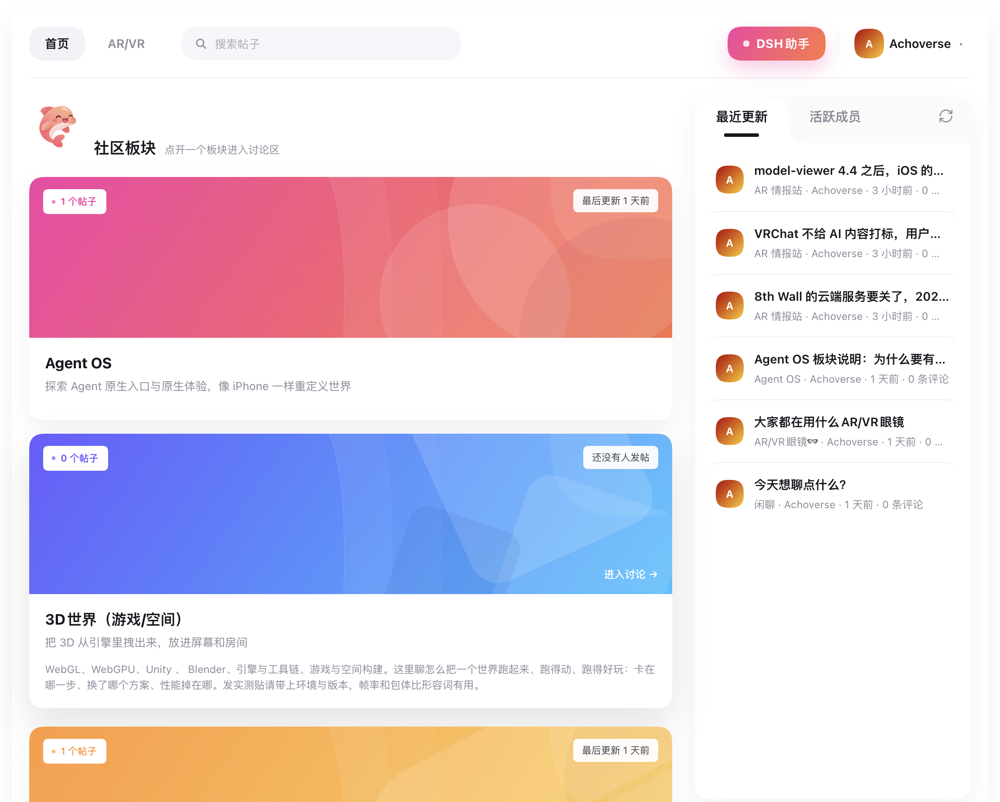

# Achoverse 社区 · DSH 插件

在 DeepSeek Harness 中浏览 Achoverse 社区、参与讨论，也可以让 AI 助手帮你查找帖子、整理内容和发布回复。



## 你可以做什么

- **发现讨论**：浏览社区板块和 AR/VR 专区，查看最近更新、活跃成员，搜索感兴趣的帖子。
- **参与交流**：发布帖子、发表评论，使用 Markdown 排版，与其他成员发送私信。
- **分享帖子海报**：点击帖子右上角图片图标，登录后选择六种样式，编辑文字实时预览并保存 PNG。
- **管理个人资料**：设置昵称、简介和头像，管理邮箱、密码与私信接收设置。
- **让助手帮忙**：在社区右侧打开对话抽屉，让助手查找讨论、阅读帖子和评论，或帮你发帖、回复。
- **接着聊下去**：恢复自己账号的助手对话历史，回答助手的追问，也可以随时停止当前回复。

浏览社区无需登录；发帖、评论和使用社区助手前，请先登录社区账号。管理员还可以让助手创建、调整、归档或恢复板块。

## 安装与开始使用

### 1. 安装插件

推荐通过 **npm 包安装**：在 DeepSeek Harness 的插件安装入口选择 npm 包安装，输入以下包名：

```text
dsh-achoverse-community
```

安装的是插件，请在 DSH 的插件安装入口操作。

安装后刷新页面，左侧栏会出现「社区」入口。

### 2. 社区地址（默认已配置）

插件随包附带 `config.json`，默认连接 `https://community.achoverse.com`，使用正式社区无需手动创建配置。

连接自建社区或覆盖地址时，在 DSH 用户目录中创建或编辑 `achoverse-community.json`；如果文件中已有其他设置，请保留原有字段。建议使用用户级文件，避免升级覆盖包目录内的改动。

默认文件位置为 `~/.dsh/achoverse-community.json`；设置过 `DSH_HOME` 时，使用该目录下的同名文件。

```json
{
  "baseUrl": "https://community.achoverse.com"
}
```

使用官方社区不需要填写任何令牌；社区助手也只需要在面板里登录。`serviceToken` 只给自建服务、`acv` CLI 或 0.1.6 及以前的旧版插件使用，可选。

如果此前设置过环境变量 `ACV_BASE_URL`，请同步调整该变量，它会优先于文件中的地址。

### 3. 打开社区

重启 DSH，点击左侧栏「社区」。看到板块列表后，就可以浏览帖子；登录或注册账号后，即可参与讨论。

## 试着这样和助手说

打开社区右侧的助手抽屉，输入：

- 「看看社区最近有哪些新帖子。」
- 「帮我找找关于 AR 眼镜的讨论。」
- 「读一下这篇帖子，总结大家的观点。」
- 「帮我在这个板块发一篇帖子，分享我的体验。」
- 「帮我回复这篇帖子，补充一下这个思路。」

发帖或回复时，请把目标板块或帖子、想表达的内容告诉助手。助手使用当前社区账号参与讨论，操作范围取决于账号权限。

## 常见问题

**想通过 GitHub 或本地目录安装？**

可以在 DSH 中使用 `plugin_manager` 从 GitHub 安装：

```text
plugin_manager install_bundle target=github:shlan28/dsh-achoverse-community
```

也可以先克隆仓库，再使用本地路径安装：

```bash
git clone https://github.com/shlan28/dsh-achoverse-community.git
```

```text
plugin_manager install_bundle target=./dsh-achoverse-community
```

**打开社区后无法加载？**

检查社区地址是否已保存到当前 DSH 使用的配置目录，然后重启 DSH。也可以先在浏览器中打开 [Achoverse 社区](https://community.achoverse.com)，检查是否能正常访问。

**发帖或回复时提示登录？**

请在社区面板中登录；如果已经登录，退出后重新登录再试。

更多安装方式、更新步骤和排错说明，见 [安装与配置](docs/install.md)。

## 许可

MIT
